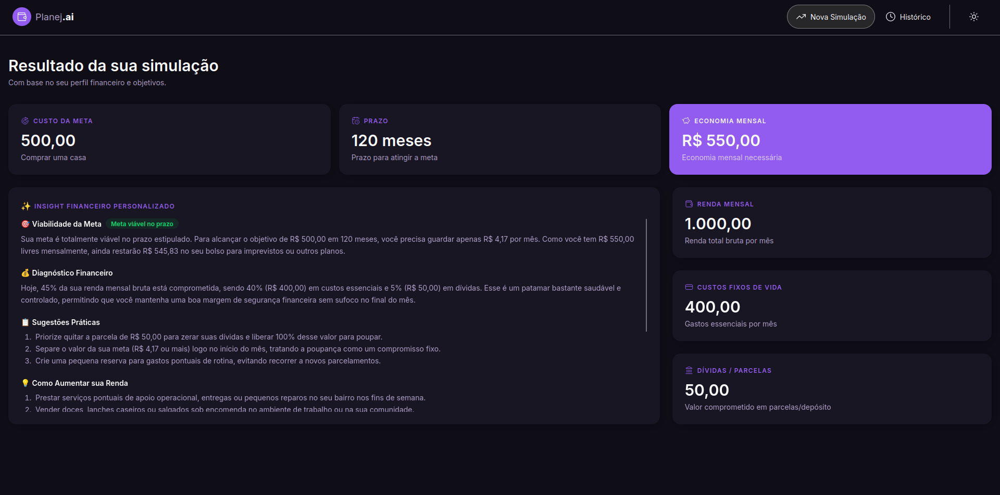
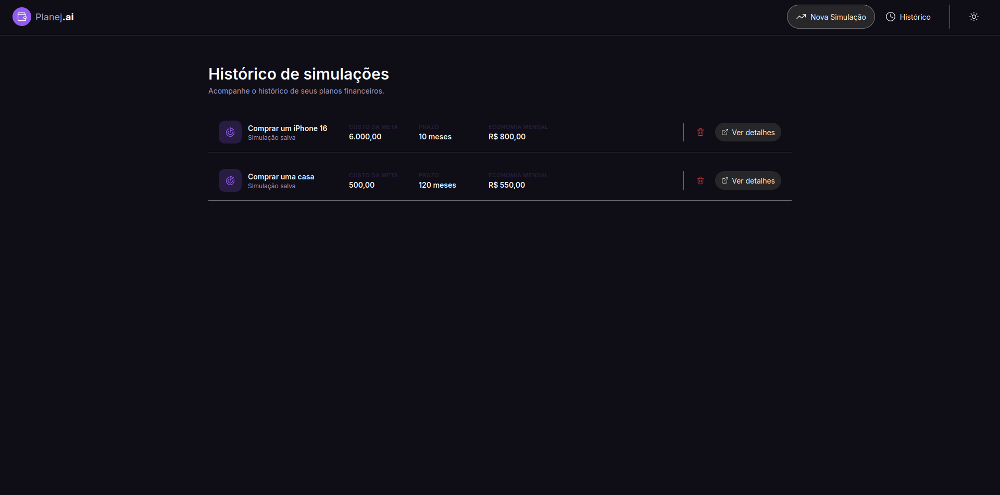

# Planejai

## Portuguese version

See [README.pt-BR.md](./README.pt-BR.md) for the Brazilian Portuguese version.

Planejai is a responsive financial planning application that turns life goals into practical, data-driven plans. Users can enter their monthly income, fixed expenses, debts, and target goal, then receive AI-generated insights on whether the goal is viable and how to reach it within the desired timeline.

## Why this project exists

The app helps people organize financial priorities, understand spare capacity, and simulate realistic strategies to achieve goals such as travel, emergency savings, or major purchases without losing sight of monthly commitments.

## Screenshots

### New simulation


### Simulation results



### History



## Main features

- Goal-based financial simulation
- Monthly income, fixed expenses, and debts input
- Goal amount and deadline tracking
- Personalized AI analysis powered by Gemini
- Simulation history saved in localStorage
- Light/dark mode toggle
- Responsive interface for desktop and mobile

## Tech stack

- React
- TypeScript
- Vite
- Tailwind CSS
- LocalStorage
- Gemini API

## Getting started

### 1) Install dependencies

```bash
npm install
```

### 2) Configure the Gemini API key

Create a `.env.local` file in the project root and add:

```bash
VITE_GEMINI_API_KEY=your_api_key_here
```

Then start the app:

```bash
npm run dev
```

Open the local URL shown by Vite to use the app.

## Important note about the API key

Because variables prefixed with `VITE_` are exposed to the browser, this setup is intended for local development and demos. In production, the Gemini API calls should be proxied through a backend so the key remains secret on the server.

## How the app works

1. The user fills out a short financial profile:
   - monthly gross income
   - fixed living costs
   - debts/instalments
   - goal name
   - goal amount
   - target timeline
2. The app calculates savings capacity and feasibility.
3. It sends the data to Gemini to generate insights, suggestions, and motivation.
4. The result is saved to history for future review.

## Project structure

```text
planejai/
├── assets/                 # Screenshots and visual assets
├── public/                # Static assets
├── src/
│   ├── components/        # UI components
│   ├── data/              # Forms and simulation data
│   ├── hooks/             # State and storage hooks
│   ├── pages/             # App pages
│   ├── services/          # AI integrations
│   ├── utils/             # Financial helpers
│   ├── App.tsx
│   ├── main.tsx
│   └── router.tsx
├── index.html
├── package.json
├── vite.config.ts
├── tailwind.config.js
├── tsconfig.json
├── eslint.config.js
└── README.md
```

## Available scripts

```bash
npm run dev
npm run build
npm run lint
npm run preview
```

## License

This project is currently distributed for learning and study purposes.
