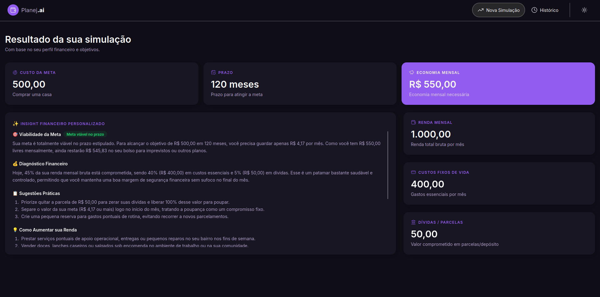
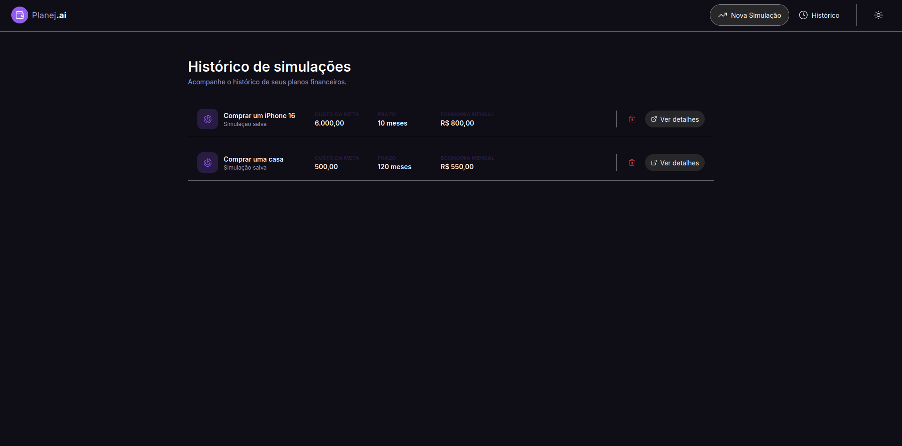

# Planejai

## English version

See [README.md](./README.md) for the English version.

Planejai é uma aplicação responsiva de planejamento financeiro que transforma metas pessoais em planos práticos e orientados por dados. O usuário informa sua renda mensal, gastos fixos, dívidas e objetivo, e recebe insights gerados por IA para avaliar se a meta é viável e como alcançá-la dentro do prazo desejado.

## Por que este projeto existe

A aplicação ajuda as pessoas a organizar prioridades financeiras, entender a capacidade de poupança e simular estratégias realistas para alcançar objetivos como viagens, reserva de emergência ou compras importantes sem perder de vista as obrigações mensais.

## Capturas de tela

### Nova simulação


### Resultados da simulação



### Histórico



## Principais recursos

- Simulação financeira por objetivo
- Cadastro de renda mensal, gastos fixos e dívidas
- Definição de valor e prazo da meta
- Análise personalizada com IA usando Gemini
- Histórico de simulações salvo no LocalStorage
- Alternância entre tema claro e escuro
- Interface responsiva para desktop e mobile

## Stack tecnológica

- React
- TypeScript
- Vite
- Tailwind CSS
- LocalStorage
- Gemini API

## Como rodar localmente

### 1) Instale as dependências

```bash
npm install
```

### 2) Configure a chave da Gemini API

Crie um arquivo `.env.local` na raiz do projeto e adicione:

```bash
VITE_GEMINI_API_KEY=sua_chave_aqui
```

Em seguida, inicie a aplicação:

```bash
npm run dev
```

Abra a URL local exibida pelo Vite para usar o app.

## Observação importante sobre a chave da API

Como variáveis com prefixo `VITE_` ficam disponíveis no navegador, essa configuração é adequada para desenvolvimento e demonstração local. Em produção, as chamadas à Gemini devem passar por um backend para que a chave fique protegida no servidor.

## Como a aplicação funciona

1. O usuário preenche um perfil financeiro resumido:
   - renda mensal bruta
   - custos fixos de vida
   - dívidas e parcelas
   - nome da meta
   - valor da meta
   - prazo desejado
2. O app calcula a capacidade de poupança e a viabilidade da meta.
3. Os dados são enviados para a Gemini, que gera insights, sugestões e motivação.
4. O resultado fica salvo no histórico para revisão futura.

## Estrutura do projeto

```text
planejai/
├── assets/                 # Imagens e materiais visuais
├── public/                # Assets estáticos
├── src/
│   ├── components/        # Componentes da interface
│   ├── data/              # Dados de formulário e simulação
│   ├── hooks/             # Hooks de estado e armazenamento
│   ├── pages/             # Páginas da aplicação
│   ├── services/          # Integrações com IA
│   ├── utils/             # Helpers financeiros
│   ├── App.tsx
│   ├── main.tsx
│   └── router.tsx
├── index.html
├── package.json
├── vite.config.ts
├── tailwind.config.js
├── tsconfig.json
├── eslint.config.js
└── README.pt-BR.md
```

## Scripts disponíveis

```bash
npm run dev
npm run build
npm run lint
npm run preview
```

## Licença

Este projeto é distribuído para fins de estudo e aprendizado.
